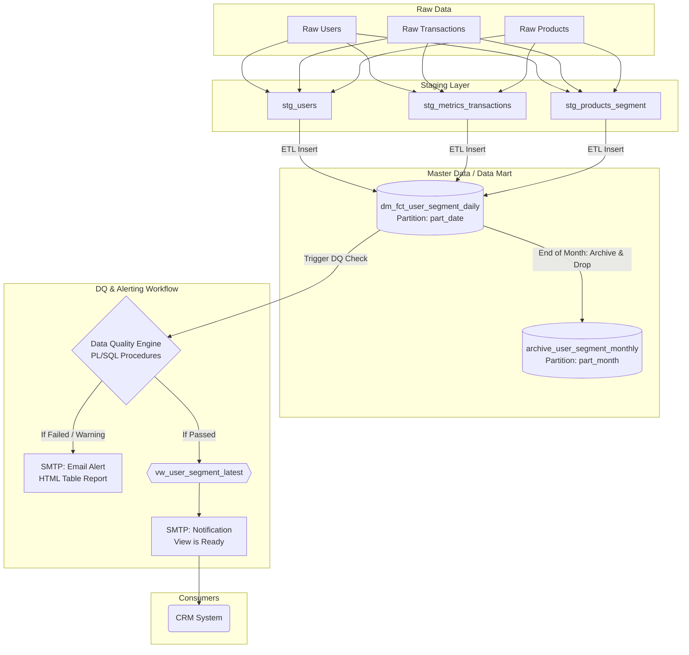

# Data Architecture Proposal: User Segmentation Data Mart

## Architecture Data Flow with DQ Gatekeeper



---

## 1. Proposed Table Design and Grain

**Grain:** 1 row per `user_id` per `part_date`

Designed as a "Wide Table" with boolean flags to easily combine multiple filtering conditions for the CRM team. The storage structure includes:

| Column Name | Data Type | Description & Proposed Criteria |
| --- | --- | --- |
| `user_id` | INT / VARCHAR | User identifier. |
| `lifecycle_stage` | VARCHAR | **Mutually Exclusive:** `New` (<= 7 days), `Active` (made a purchase in L30D), `Dormant` (no purchase in L90D), `Churn_Risk` (no purchase in 30-90D). |
| `value_tier` | VARCHAR | **Mutually Exclusive:** Based on LTV or 90-day GMV (`High`, `Medium`, `Low`). |
| `is_repeat_buyer` | BOOLEAN | **Behavioral Flag:** True if >= 2 completed orders. |
| `is_bnpl_user` | BOOLEAN | **Behavioral Flag:** True if the user uses Buy Now Pay Later. |
| `is_wallet_user` | BOOLEAN | **Behavioral Flag:** True if wallet balance > 0 or has wallet transactions. |
| `is_discount_hunter` | BOOLEAN | **Behavioral Flag:** True if > 70% of orders applied promo codes. |
| `part_date` | INT | Data snapshot date (Partition Column) - [YYYYMMDD]. |

>[!NOTE]
>
> In datamart final, all the `metrics` calculation must in `aggegrate` calculation

---

## 2. Primary Key and Partition Column

* **Primary Key:** `(part_date, user_id)`. The `part_date` must be included in the PK to support Native Partitioning.
* **Native Partitioning:** The `mart_user_segment_daily` table is physically partitioned by day (Range Partitioning on `part_date`).
* **Indexing:** Create a Composite B-Tree Index on `(part_date, lifecycle_stage, user_id)` to optimize customer list extraction speed.

---

## 3. Snapshot vs Changelog vs Hybrid Approach

**Decision: Hybrid Model (Daily Snapshot + Monthly Archive)**

* **Current State:** Retain `part_date` Snapshots for the last 30 - 60 days in the `mart_user_segment_daily` table.
* **Historical State:** On the 1st of every month, aggregate the previous month's Snapshots and move them to the `archive_user_segment_monthly` table (partitioned by month).
* Then execute a `DROP PARTITION` command for the old days in the Daily table to immediately reclaim storage space (avoiding dead tuples/table bloat caused by the `DELETE` command).

---

## 4. Refresh / Overwrite Logic

Daily Batch Job execution process (T+1) run in the early morning:

1. **Staging Load:** Ingest and update data into `stg_users`, `stg_metrics_transactions`, and `stg_products_segment`.
2. **Master Load:** Join the Staging tables and Insert data into the new partition for yesterday (`part_date = CURRENT_DATE - 1`).

---

## 5. Data Quality Checks & Alerting Workflow (Gatekeeper)

This is the safety gatekeeper before data reaches the end-users. The entire logic is encapsulated in **PL/SQL**, scheduled to trigger immediately after the Master Load step:

### Base Checks

* **Duplicate Check:** Ensure there are no duplicate rows (based on `user_id` + `part_date`) in the Master table.
* **Row Stability Check:** Compare the total RowCount of today's `part_date` against the 7-day moving average to detect abnormal fluctuations (prevents missing or duplicated data issues from the Source).
* **Trend-Threshold Check:** Monitor fluctuations of critical metrics (e.g., The `High_Value_User` segment should not increase/decrease by more than 10% compared to yesterday).
* **Logic & Reconcile Check:** Perform cross-validation (site logic check). Example: The total GMV of users in the calculated segment must reconcile with the total GMV from the raw Transactions table.

### Alerting Workflow (this is available in `Oracle` -- else can work around with `Python` or `Dbt`)

* `PL/SQL` will format the check results into an intuitive **HTML** table.
* Send the report via **SMTP Email** to the Data Team for validation.
* **Only when all checks pass** will the system publish the data to the `vw_user_segment_accessibility` View and automatically send a "Data is Ready" email to the CRM team.

---

## 6. Schema Evolution & Trade-offs

### Column Addition Process (Schema Evolution)

To accommodate Business needs for continuously creating new segments without causing Data Pipeline downtime:

1. Add the calculation logic to `stg_metrics_transactions`.
2. Execute 
```sql
ALTER TABLE mart_user_segment_daily 
ADD COLUMN new_segment_flag BOOLEAN DEFAULT NULL`
```
Setting `DEFAULT NULL` prior to insertion ensures legacy code does not fail due to a "column count mismatch" error.

3. Update the `INSERT` statement in the Master Load workflow to populate data into the new column.

### Trade-offs

* **Storage Cost vs Query Performance:** Higher storage costs to maintain a 1 row/user/day Snapshot, but this is offset by maximum Read performance for the CRM team since no JOINs are required.
* **Wide Table Flexibility:** The table will expand horizontally as more columns are added. However, adding columns is efficiently handled via `ALTER TABLE ... DEFAULT NULL` without impacting the current system workflows.
* **Adjusting Logic will not break whole pipeline**: Business logic modifications (e.g., updating segment definitions) are contained within the Staging layer. This decoupling ensures that changing how a metric is calculated does not cause schema failures or disrupt downstream CRM consumption.