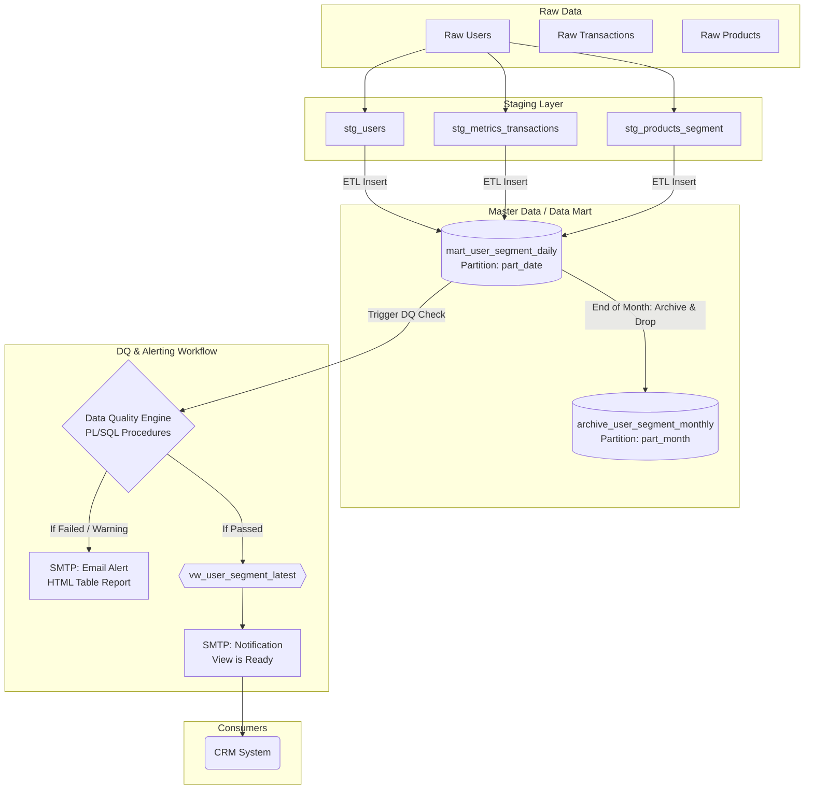

# Data Architecture Proposal: User Segmentation Data Mart

## Architecture Data Flow with DQ Gatekeeper



---

## 1. Proposed Table Design and Grain

**Grain:** 1 row per `user_id` per `part_date`.

Thiết kế bảng dạng "Wide Table" (Bảng rộng) với các cờ (flags) để dễ dàng kết hợp nhiều điều kiện lọc cho team CRM. Cấu trúc lưu trữ bao gồm:

| Column Name | Data Type | Description & Proposed Criteria |
| --- | --- | --- |
| `user_id` | INT / VARCHAR | ID định danh người dùng. |
| `lifecycle_stage` | VARCHAR | **Độc quyền (Mutually Exclusive):** `New` (<= 7 ngày), `Active` (có mua hàng L30D), `Dormant` (không mua L90D), `Churn_Risk` (không mua 30-90D). |
| `value_tier` | VARCHAR | **Độc quyền:** Dựa trên LTV hoặc GMV 90 ngày (`High`, `Medium`, `Low`). |
| `is_repeat_buyer` | BOOLEAN | **Behavioral Flag:** True nếu có >= 2 đơn hàng hoàn tất. |
| `is_bnpl_user` | BOOLEAN | **Behavioral Flag:** True nếu dùng Buy Now Pay Later (Trả sau). |
| `is_wallet_user` | BOOLEAN | **Behavioral Flag:** True nếu có số dư ví > 0 hoặc phát sinh giao dịch ví. |
| `is_discount_hunter` | BOOLEAN | **Behavioral Flag:** True nếu > 70% đơn hàng có áp dụng mã khuyến mãi. |
| `part_date` | DATE | Ngày chốt số liệu (Partition Column). |

---

## 2. Primary Key and Partition Column

* **Primary Key:** `(part_date, user_id)`. Bắt buộc `part_date` phải nằm trong PK để hỗ trợ Native Partitioning.
* **Native Partitioning:** Bảng `mart_user_segment_daily` được phân vùng vật lý theo từng ngày (Partition by Range trên `part_date`).
* **Indexing:** Tạo Composite B-Tree Index trên `(part_date, lifecycle_stage, user_id)` để tối ưu tốc độ trích xuất danh sách khách hàng.

---

## 3. Snapshot vs Changelog vs Hybrid Approach

**Quyết định: Mô hình Hybrid (Daily Snapshot + Monthly Archive)**

* **Current State:** Lưu `part_date` Snapshot cho 30 - 60 ngày gần nhất tại bảng `mart_user_segment_daily`.
* **Historical State:** Ngày 1 hàng tháng, gộp Snapshot tháng trước đưa vào bảng `archive_user_segment_monthly` (phân vùng theo tháng).
* Sau đó chạy lệnh `DROP PARTITION` các ngày cũ trên bảng Daily để giải phóng dung lượng rác ngay lập tức (tránh hiện tượng dead tuples/bloat do lệnh DELETE).

---

## 4. Refresh / Overwrite Logic

Quy trình chạy Batch Job hàng ngày (T+1) vào rạng sáng:

1. **Staging Load:** Cập nhật dữ liệu vào `stg_users`, `stg_metrics_transactions`, và `stg_products_segment`.
2. **Master Load:** Join các bảng Staging và Insert vào Partition mới của ngày hôm qua (`part_date = CURRENT_DATE - 1`).

---

## 5. Data Quality Checks & Alerting Workflow (Gatekeeper)

Đây là chốt chặn an toàn trước khi data đến tay người dùng. Toàn bộ logic được đóng gói bằng **PL/SQL**, lên lịch (schedule trigger) chạy ngay sau bước Master Load:

### Bộ Test cơ bản (Base Checks)

* **Duplicate Check:** Kiểm tra không có dòng lặp lại (theo `user_id` + `part_date`) từ bảng Master.
* **Row Stability Check:** Đếm tổng số dòng (RowCount) của `part_date` hôm nay so với trung bình 7 ngày trước xem có biến động bất thường không (tránh lỗi hụt data hoặc nhân đôi data từ Source).
* **Trend-Threshold Check:** Kiểm tra sự biến động của một số chỉ số quan trọng (VD: Tập `High_Value_User` không được tăng/giảm quá 10% so với ngày hôm qua).
* **Logic & Reconcile Check:** Kiểm tra chéo (site logic check). Ví dụ: Tổng số GMV của các user trong tập tính toán phải khớp (reconcile) với tổng GMV từ bảng gốc Transactions.

### Alerting Workflow (Cơ chế thông báo)

* PL/SQL sẽ format kết quả check thành một bảng **HTML** trực quan.
* Gửi báo cáo qua **SMTP Email** cho Data Team để validate.
* **Chỉ khi Passed toàn bộ**, hệ thống mới public data ra View `vw_user_segment_latest` và tự động gửi email "Data is Ready" cho team CRM.

---

## 6. Schema Evolution & Trade-offs

### Quy trình thêm Cột (Schema Evolution)

Để đáp ứng nhu cầu Business liên tục tạo thêm các segment mới mà không làm chết luồng Data Pipeline (Downtime):

1. Thêm logic tính toán vào `stg_metrics_transactions`.
2. Chạy lệnh `ALTER TABLE mart_user_segment_daily ADD COLUMN new_segment_flag BOOLEAN DEFAULT NULL`. Việc để `DEFAULT NULL` trước khi Insert đảm bảo các mã code cũ không bị lỗi "column count mismatch".
3. Cập nhật câu lệnh `INSERT` của luồng Master Load để đẩy dữ liệu vào cột mới.

### Trade-offs (Đánh đổi)

* **Storage Cost vs Query Performance:** Tốn chi phí lưu trữ Snapshot 1 row/user/day, bù lại tốc độ Read cho CRM là cực đại vì không cần JOIN.
* **Wide Table Flexibility:** Bảng sẽ phình to theo chiều ngang khi thêm nhiều cột. Tuy nhiên, xử lý thêm cột rất gọn nhẹ bằng `ALTER TABLE ... DEFAULT NULL` mà không ảnh hưởng luồng hệ thống hiện tại.

```

```